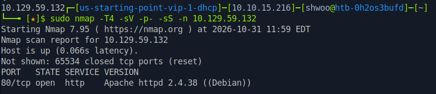
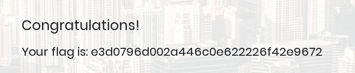

<div class="notion-page" markdown="1">

해당 문제는 HTB에서 공개 가능한 문제로 블로그에 라이트업 공개가 허용된 문제이므로 포스팅 합니다.

<div class="notion-blank"></div>

<div class="notion-blank"></div>

### 문제 개요 
{: id="문제-개요"}

Appointment는 매우 쉬운 난이도의 Linux 머신으로, SQL 데이터베이스를 사용하는 웹 애플리케이션을 대상으로 초보자 수준의 SQL Injection 기법을 실습할 수 있는 머신입니다.

<div class="notion-blank"></div>

<div class="notion-blank"></div>

### TASK1
{: id="task1"}

> What does the acronym SQL stand for?

<code>Structured Query Language</code>

<div class="notion-blank"></div>

<div class="notion-blank"></div>

### TASK2
{: id="task2"}

> What is one of the most common type of SQL vulnerabilities?

<code>SQL Injection</code>

<div class="notion-blank"></div>

<div class="notion-blank"></div>

### TASK3
{: id="task3"}

> What is the 2021 OWASP Top 10 classification for this vulnerability?

<code>A03:2021-Injection</code>

<div class="notion-blank"></div>

<div class="notion-blank"></div>

### TASK4
{: id="task4"}

> What does Nmap report as the service and version that are running on port 80 of the target?

{: w="888" h="193" }

<code>Apache httpd 2.4.38 ((Debian))</code>

<div class="notion-blank"></div>

<div class="notion-blank"></div>

### TASK5
{: id="task5"}

> What is the standard port used for the HTTPS protocol?

<code>443</code>

<div class="notion-blank"></div>

<div class="notion-blank"></div>

### TASK6
{: id="task6"}

> What is a folder called in web-application terminology?

<code>directory</code>

<div class="notion-blank"></div>

<div class="notion-blank"></div>

### TASK7
{: id="task7"}

> What is the HTTP response code that is returned for <code>Not Found</code> errors?

<code>404</code>

<div class="notion-blank"></div>

<div class="notion-blank"></div>

### TASK8
{: id="task8"}

> Gobuster is one tool used to brute force directories on a webserver. What switch do we use with Gobuster to specify we&#x27;re looking to discover directories, and not subdomains?

서브 도메인은 dns 모드로 탐색하는 것이고 dir이 디렉터리를 탐색하는 모드이다. 

<code>dir</code>

<div class="notion-blank"></div>

<div class="notion-blank"></div>

### TASK9
{: id="task9"}

> What single character can be used to comment out the rest of a line in MySQL?

<code>#</code>

<div class="notion-blank"></div>

<div class="notion-blank"></div>

### TASK10
{: id="task10"}

> If user input is not handled carefully, it could be interpreted as a comment. Use a comment to login as admin without knowing the password. What is the first word on the webpage returned?

아마 로그인 시 로직은 다음과 같이 되어있지 않을까 싶다.

```sql
SELECT * FROM users WHERE username = '{username}' AND password = '{password}';
```

그럼 우리는 다음과 같은 값을 넣으면 username 값의 password 절의 AND 가 주석으로 실행되지 않는 코드가 되며 admin 으로 로그인이 가능하다. 

```sql
SELECT * FROM users WHERE username = 'admin' # AND password = '1234';
```

{: w="719" h="148" }

<code>Congratulations</code>

<div class="notion-blank"></div>

<div class="notion-blank"></div>

### TASK11 
{: id="task11"}

> Submit the flag located in the webpage after bypassing the login.

<code>e3d0796d002a446c0e622226f42e9672</code>

<div class="notion-blank"></div>

</div>
