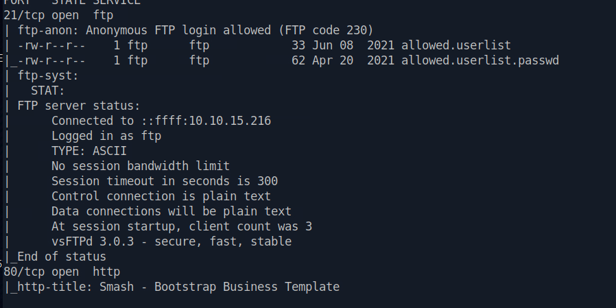
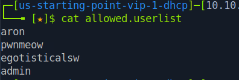
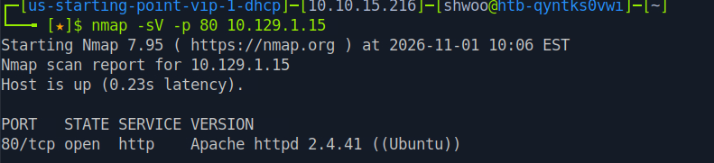
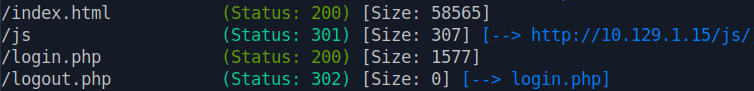
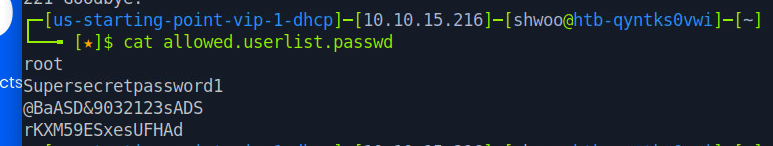
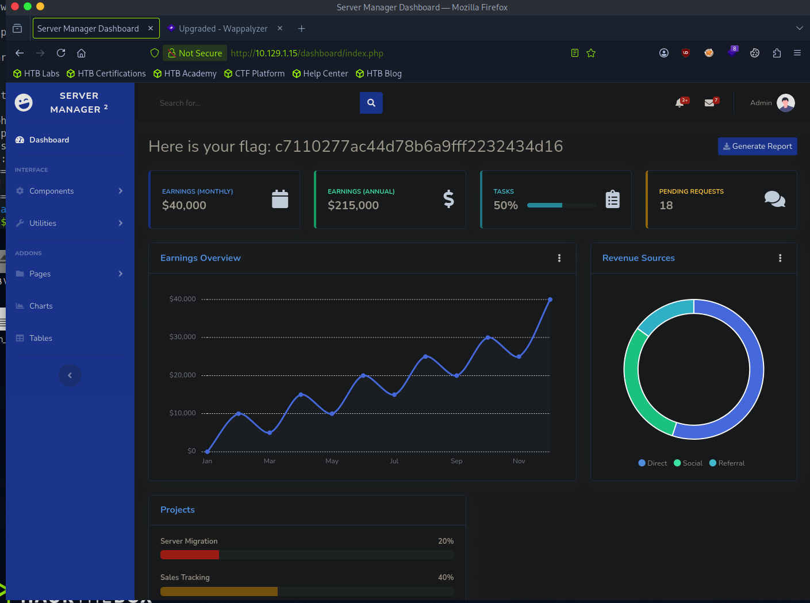

<div class="notion-page" markdown="1">

해당 문제는 HTB에서 라이트업 공개가 가능한 문제이므로 포스팅 합니다.

<div class="notion-blank"></div>

<div class="notion-blank"></div>

### 문제 개요 
{: id="문제-개요"}

Crocodile은 잘못 설정된 인증 방식과 민감한 정보 노출의 위험성을 보여주는 매우 쉬운 난이도의 Linux 머신입니다.

취약한 FTP 서버가 익명 인증(Anonymous Authentication) 을 허용하도록 잘못 설정되어 있습니다. 서버를 열거(Enumeration)하는 과정에서 평문(Cleartext)으로 저장된 계정 인증 정보가 포함된 민감한 파일을 발견할 수 있습니다.

이후 웹사이트를 열거하고 퍼징(Fuzzing)하면 숨겨진 로그인 페이지를 찾을 수 있으며, 앞서 획득한 계정 정보를 사용하여 관리자 패널(Admin Panel) 에 접근할 수 있습니다.

<div class="notion-blank"></div>

<div class="notion-blank"></div>

### TASK1
{: id="task1"}

> What Nmap scanning switch employs the use of default scripts during a scan?

<code>-sC</code>

<div class="notion-blank"></div>

<div class="notion-blank"></div>

### TASK2
{: id="task2"}

> What service version is found to be running on port 21?

{: w="898" h="449" }

<code>vsftpd 3.0.3</code>

<div class="notion-blank"></div>

<div class="notion-blank"></div>

### TASK3
{: id="task3"}

> What FTP code is returned to us for the &quot;Anonymous FTP login allowed&quot; message?

<code>230</code>

<div class="notion-blank"></div>

<div class="notion-blank"></div>

### TASK4
{: id="task4"}

> After connecting to the FTP server using the ftp client, what username do we provide when prompted to log in anonymously?

<code>anonymous</code>

<div class="notion-blank"></div>

<div class="notion-blank"></div>

### TASK5
{: id="task5"}

> After connecting to the FTP server anonymously, what command can we use to download the files we find on the FTP server?

<code>get</code>

<div class="notion-blank"></div>

<div class="notion-blank"></div>

### TASK6
{: id="task6"}

> What is one of the higher-privilege sounding usernames in &#x27;allowed.userlist&#x27; that we download from the FTP server?

```plaintext
ftp 10.129.1.15

get allowed.userlist
```

{: w="396" h="134" }

<code>admin</code>

<div class="notion-blank"></div>

<div class="notion-blank"></div>

### TASK7
{: id="task7"}

> What version of Apache HTTP Server is running on the target host?

```plaintext
sudo nmap -sV -p 80 10.129.1.15
```

{: w="791" h="181" }

<code>httpd 2.4.41</code>

<div class="notion-blank"></div>

<div class="notion-blank"></div>

### TASK8
{: id="task8"}

> What switch can we use with Gobuster to specify we are looking for specific filetypes?

<code>-x</code>

<div class="notion-blank"></div>

<div class="notion-blank"></div>

### TASK9
{: id="task9"}

> Which PHP file can we identify with directory brute force that will provide the opportunity to authenticate to the web service?

{: w="754" h="91" }

<code>login.php</code>

<div class="notion-blank"></div>

<div class="notion-blank"></div>

### TASK10
{: id="task10"}

> Submit the flag located in the webpage.

allowed.userlist.passwd 파일에서 비밀번호를 확인해보면 다음과 같이 나온다. admin이 4번째 행이었으니 rKXM59ESxesUFHAd을 사용해서 로그인하면 된다. 

{: w="773" h="146" }

{: w="1409" h="1049" }

<code>c7110277ac44d78b6a9fff2232434d16</code>

<div class="notion-blank"></div>

<div class="notion-blank"></div>

<div class="notion-blank"></div>

<div class="notion-blank"></div>

</div>
